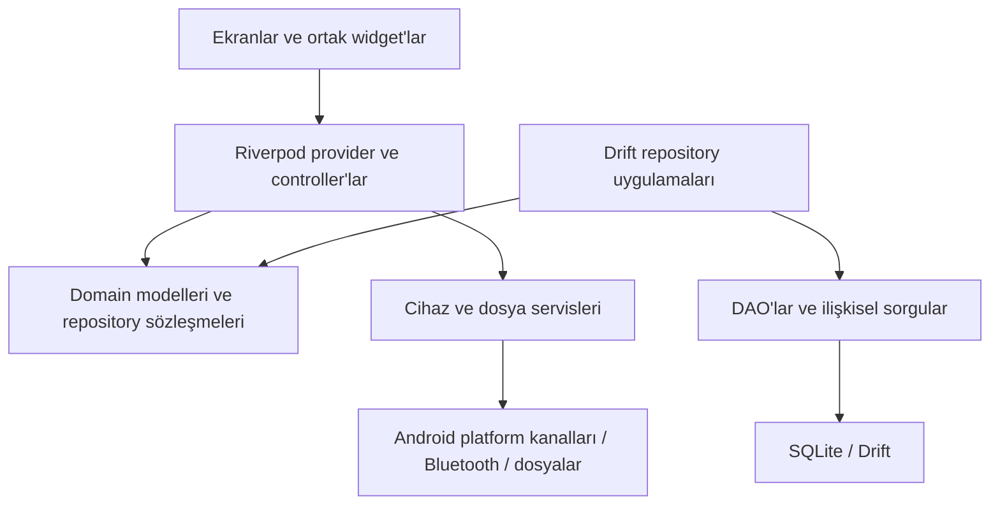
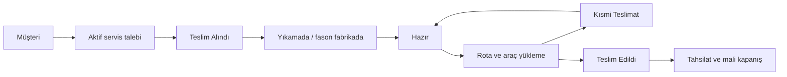

# Vento ekosistemi — uygulama analizi ve çıkarımlar

İnceleme tarihi: **14 Kasım 2026**  
İnceleme kökü: `D:/projects/vento`  
Kapsam: VentoPOS ana uygulaması, VentoPOS_Keygen yardımcı uygulaması ve kökteki sürüm araçları.  
Durum: **Kesilen düzeltme çalışması yeniden denetlendi; bulunan ek kod eksikleri giderildi. Güncel kaynak kod ve doğrulama durumu bölüm 21'dedir. Bölüm 20'deki APK paketleri bu son ek düzeltmelerden önce üretilmiştir. İlk analiz ve ara teslimler tarihsel kayıt olarak korunmuştur.**

## 1. Amaç, yöntem ve kanıt sınırı

Bu belge, uygulamayı sonraki görevlerde doğru bağlamla geliştirebilmek için hazırlanmış bir teknik analiz raporudur. Mimariyi, iş akışlarını, kalıcılık sınırlarını, donanım bağlantılarını, lisans protokolünü, doğrulama sonuçlarını ve mevcut riskleri birlikte açıklar.

`AGENTS.md` dosyaları geliştirme standartları olarak okundu. Bu dosyalardaki bir gerekliliğin yazılı olması, uygulamada eksiksiz sağlandığına kanıt sayılmadı. Aşağıdaki çıkarımlar kaynak kod, yapılandırmalar, testler ve yerel komut sonuçlarına dayanır. Belgelerdeki sürüm oluşturma, commit veya push yönergeleri bu analiz görevinin bir parçası olarak yürütülmedi.

İzlenen yöntem:

1. İki bağımsız deponun durumunu, sürümlerini ve dosya envanterini çıkarmak.
2. Başlangıç, lisans, gezinme, Riverpod durum yönetimi, repository ve Drift bağlantılarını izlemek.
3. Müşteri → servis talebi → sipariş → yıkama/fabrika → rota → teslimat → tahsilat zincirini incelemek.
4. Fiş numarası, iade, kısmi teslimat, minimum servis bedeli, yedekleme ve senkronizasyon gibi kritik sınırları karşılaştırmak.
5. Mevcut statik analizleri ve test paketlerini çalıştırmak.

Dosya envanteri tüm `lib/` ve `test/` ağaçlarını kapsar; ayrıntılı okuma kritik yürütme yolları ve bunların testleri üzerinde yoğunlaştırılmıştır. Bütün kaynak satırlarının tek tek denetlendiği, eksiksiz güvenlik denetimi yapıldığı veya her ekranın fiziksel cihazda kullanıldığı iddia edilmez.

Kanıt ayrımı:

- **Doğrulandı:** Kaynakta doğrudan görülen veya bu oturumdaki komutlarla doğrulanan davranış.
- **Risk / çıkarım:** Kaynağın yapısından çıkan olası hata veya bakım etkisi; sahada yaşandığı ayrıca doğrulanmış değildir.
- **Sınanmadı:** Fiziksel Android, Bluetooth yazıcı, gerçek rehber, canlı sunucu veya dağıtılan APK gerektiren davranış.

## 2. Ekosistemin gerçek yapısı

| Özellik | VentoPOS | VentoPOS_Keygen |
| --- | --- | --- |
| Rol | Müşteri ve saha operasyonları | Yöneticiye özel çevrimdışı lisans üretimi |
| Dizin | `D:/projects/vento/ventoPOS` | `D:/projects/vento/ventoPOS_Keygen` |
| Dart paket adı | `ventopos` | `ventopos_keygen` |
| Android uygulama kimliği | `com.ventopos.ventopos` | `com.ventopos.ventopos_keygen` |
| Mevcut sürüm | `2.8.4+25` | `1.1.2+4` |
| İncelenen HEAD | `ecab31f` | `6ea50c1` |
| Üretilmiş dosyalar hariç `lib/` Dart dosyası | 750 | 23 |
| `*_test.dart` dosyası | 143 | 1 |
| Yerel veri | Drift SQLite, SharedPreferences, güvenli depolama, medya dosyaları | SharedPreferences |

Her iki alt dizinin kendi `.git` deposu vardır. İnceleme başlangıcında ve doğrulama komutları sonrasında iki deponun çalışma ağacı temizdi. İzlenen `.gitmodules` dosyası bulunmadı. Ortak kök, uygulama kodunu tek depoda birleştiren bir monorepo düzeni oluşturmuyor; iki depoyu yan yana tutan bir çalışma alanı işlevi görüyor.

VentoPOS kaynak dağılımı:

| Katman | Dart dosyası |
| --- | ---: |
| `core` | 41 |
| `domain` | 40 |
| `data` | 66 |
| `presentation` | 602 |
| `main.dart` | 1 |

Üretilmiş `.g.dart` dosyaları hariç VentoPOS `lib/` ağacı yaklaşık **182.507 satır** içeriyor. `presentation` içinde 31 provider dosyası, 32 ekran dosyası, 28 tasarım sistemi dosyası ve 510 widget dosyası var. Bunlar boş satırlar ve açıklamalar dahil kaynak boyutu göstergeleridir; karmaşıklık veya kalite puanı değildir.

**Temel çıkarım:** Ürün, halı/yıkama işletmesinin müşteri, atölye, saha lojistiği ve finans süreçlerini aynı cihazda birleştiren kapsamlı bir işletme uygulamasına dönüşmüş. Etiket basımı bu yapının önemli bir alt modülü; uygulamanın tamamını tek başına tanımlamıyor.

## 3. Teknoloji ve çalışma modeli

Her iki proje Flutter ve Dart kullanıyor. Yerel SDK meta verisinde Flutter `3.47.2`, Dart `3.13.2` bulunuyor; iki `pubspec.yaml` dosyası da Dart `^3.13.2` istiyor. Bu bilgi yerel kurulumdan alınmıştır; SDK güncelliği hakkında internet araştırması yapılmamıştır.

Ortak yapılandırma:

- Android `minSdk = 24`, `compileSdk = 36`, `targetSdk = 36`.
- Java/Kotlin hedefi 17.
- Riverpod `^2.6.1` ile ağırlıklı olarak `StateNotifier` tabanlı durum yönetimi.
- Türkçe operasyon arayüzü ve İngilizce kaynak tanımlayıcıları.
- Mağaza üzerinden zorunlu dağıtım yerine imzalı APK ve yerinde güncelleme yaklaşımı.

VentoPOS'un belirgin bağımlılıkları Drift/SQLite, Bluetooth termal baskı, cihaz rehberi, SharedPreferences, güvenli depolama, görsel işleme, dosya seçimi/paylaşımı ve Excel aktarımıdır. Lisans doğrulaması `cryptography` üzerinden Ed25519 kullanır. Keygen aynı kriptografi kitaplığıyla imza üretir; Drift veya sunucu gerektirmez.

VentoPOS `analysis_options.yaml` dosyasında `strict-casts`, `strict-raw-types`, beklenmeyen await eksikleri, abonelik kapatma ve `BuildContext` kullanımı gibi ek kontroller var. Keygen daha sade `flutter_lints` yapılandırmasına sahip. Mimari kuralların tamamı derleyici/linter tarafından otomatik uygulanmıyor.

## 4. Mimari ve bağımlılıkların fiili durumu

Hedeflenen bağımlılık yönü `presentation → domain ← data`. Uygulamanın önemli bölümü bunu repository sözleşmeleri üzerinden izliyor:



Repository sözleşmelerinin merkezi [pos_repositories.dart](D:/projects/vento/ventoPOS/lib/domain/repositories/pos_repositories.dart), uygulamalarının merkezi [drift_pos_repositories.dart](D:/projects/vento/ventoPOS/lib/data/repositories/drift_pos_repositories.dart), bağımlılıkların bağlandığı ana yer [database_providers.dart](D:/projects/vento/ventoPOS/lib/data/database/database_providers.dart).

Merkezi provider'ların sorumlulukları:

| Bileşen | Fiili sorumluluk |
| --- | --- |
| `TrackingNotifier` | Hizmet kataloğu, müşteriler, talepler, siparişler, ödeme, rehber ilişkileri, geri yükleme ve etiket köprüsü |
| `CarpetOrderFormController` | Sipariş taslağı, giriş modları, fiyatlandırma, kalemler, değişiklik kilitleri |
| `DistributionPlanningNotifier` | Hazır havuz, karma alım/teslimat rotaları, sıralama, araç yükleme ve rota durumu |
| `SubcontractorNotifier` | Fason fabrikalar, atamalar, borçlar, ödemeler ve açılış bakiyesi |
| `ExpenseNotifier` | Masraf kayıtları, kategoriler ve filtreler |
| `TemplateAndBrandingNotifier` | Etiket şablonları ve firma kimliğinin ortak durumu |
| `PrinterNotifier` | Bağlantı, yeniden bağlanma, yazdırma ve kalibrasyon |
| `SyncAndBackupSchedulerNotifier` | Yerel yedekleme ve uzak senkronizasyon zamanlaması |
| `LicenseNotifier` | Cihaz kimliği, aktivasyon ve lisans doğrulama |

Bu mimari testlerde servis/repository değiştirmeyi mümkün kılıyor. Drift akışları ana provider'ları güncelliyor; widget'lar seçiciler ve provider izleme üzerinden yeniden çiziliyor. `tracking_state.dart` ve `tracking_selectors.dart` ayrıştırması mevcut.

**Ancak katman sınırları tam korunmuyor:** Adres ayrıştırma/konum widget'ları doğrudan `appDatabaseProvider.customersDao` kullanıyor. Taşeron provider'ı doğrudan `SubcontractorsDao` türüne bağımlı. Ana tracking provider'ı sistem sıfırlamada veritabanına doğrudan erişiyor. Bunlar yalnızca adlandırma farkı değil, yazılı mimari kuraldan somut sapmalardır; ayrıntıları bulgular bölümünde yer alır.

## 5. Başlangıç, lisans kapısı ve gezinme

Başlangıç sırası [main.dart](D:/projects/vento/ventoPOS/lib/main.dart) içinden `ProviderScope → VentoPosApp → MaterialApp → LicenseGateWidget` olarak ilerliyor.

`LicenseGateWidget`, lisans ve ilk kurulum durumlarını birlikte izliyor:

1. Lisans/kurulum durumu henüz yüklenmediyse doğrulama ekranı gösteriliyor.
2. Lisans yoksa veya süresi dolmuşsa aktivasyon ekranı açılıyor.
3. Lisans geçerliyse ve kurulum tamamlanmamışsa kurulum sihirbazı açılıyor.
4. Lisans ve kurulum hazırsa ana uygulama kabuğuna geçiliyor.

Ana kabukta beş hedef var: **Panel, Siparişler, Rotalama, Müşteriler, Etiket**. `IndexedStack` kullanılması sekme durumunu koruyor; aynı zamanda ekran/provider yaşam döngülerinin birlikte değerlendirilmesini gerektiriyor.

[app_navigation_provider.dart](D:/projects/vento/ventoPOS/lib/presentation/providers/app_navigation_provider.dart) içinde Siparişler seçimi doğrudan sipariş alt sekmesini açıyor. Servis talepleri için ayrı `openServiceRequestsTab()` çağrısı var. Dağıtım/rotalama geçişleri sipariş alt sekme indeksini değiştirmiyor. Sipariş ve rota modülleri arasındaki gezinme ayrımı kaynakta uygulanmış.

Ana kabuk ilk çizimden sonra izinleri, rehber önbelleğini, hesap bilgisini, bölgesel ayarları, sürüm bilgisini ve güncelleme güvenlik kontrolünü başlatıyor. Yazıcı otomatik bağlantısı `unawaited(...)` ile çalışıyor. Öncesindeki bazı başlangıç işleri sıralı bekleniyor; bu, yazıcının ilk bağlantı denemesini geciktirebilir, fakat widget ağacının ilk çizimini yazıcı bağlantısına bağlamıyor.

Uygulama öne döndüğünde rehber önbelleği, arama geçmişi ve kaçırılan zamanlamalar yeniden değerlendiriliyor. Alt gezinme `SafeArea` içinde. Bu gözlem, bütün modal ekranların tüm cihazlarda güvenli alan davranışının doğrulandığı anlamına gelmez.

## 6. Ana iş akışı ve iş kuralları

### 6.1. Müşteri ve adres

Müşteri; ana kayıt, birden fazla telefon ve birden fazla yapılandırılmış adres olarak modelleniyor. Telefon ve adresler ilişkisel tablolara ayrılmış. Türkçe ad/telefon/adres normalleştirme yardımcıları, kara liste kontrolleri, ilçe/mahalle kataloğu ve cihaz üzerindeki adres adayları mevcut.

Adres formunda asansör bilgisi `bool?` ve merkezi `VentoElevatorSelector` ile temsil ediliyor: belirtilmedi, var, yok. Bu üç durumun ayrı tutulması ürünün gerçek veri modelinin parçası. Gelecekteki değişiklikte `null` bilgisinin otomatik olarak `false` yapılması veri anlamını değiştirir.

Rehber araması ve Google hesabına müşteri yazma iki ayrı işlev. Native sınıfın adında `Gmail` bulunması bütün okumanın Google'a sınırlı olduğu anlamına gelmiyor: tüm aktif kaynakları, `RawContacts.DELETED = 0` filtresiyle ve fotoğrafsız parçalarda tarayan yol mevcut. Google hesabına özgü filtreler yazma/senkronizasyon işlemlerinin belirli bölümlerinde ayrıca kullanılıyor.

### 6.2. Servis talebi

Talep; müşteri, telefon/adres, alım zamanlaması, not ve öncelik etiketlerini taşıyor. `urgent`, `returnPickup`, `largeLoad` etiketleri operasyonel ayrımlar yaratıyor. İade etiketi yalnızca görsel bir işaret değil; oluşturulacak siparişin mali davranışını belirliyor.

Yeni sipariş oluşturulurken aktif bir kaynak servis talebi aranıyor. Kara listedeki müşteri, geçersiz kaynak veya uyumsuz standart/iade dönüşümü reddediliyor. Bu kontrol [TrackingNotifier.saveOrder](D:/projects/vento/ventoPOS/lib/presentation/providers/tracking_provider.dart:2325) içinde yer alıyor.

### 6.3. Sipariş oluşturma ve yaşam döngüsü

Sipariş iki giriş biçimini destekliyor:

- Doğrudan adet, m² ve toplam tutar.
- Hizmet kataloğundan fiyatlandırılan kalemler.

Durumlar: `received`, `washing`, `ready`, `outForDelivery`, `partiallyDelivered`, `delivered`, `cancelled`. Bunları yalnızca tek yönlü basit bir durum zinciri olarak görmek yetersiz; kontrollü geri alma, yeniden yıkama, kısmi teslimat ve mali kapanış kuralları da var.



Yeni siparişin durumu `saveOrder` içinde koşulsuz `CarpetOrderStatus.received` olarak ayarlanıyor. Kaynak talep daha sonra siparişe dönüştürülmüş olarak işaretleniyor. Mevcut siparişin fiş numarası ve operasyon türü korunuyor. Silinmiş, iptal edilmiş veya kapanmış kayıtların normal düzenlenmesi engelleniyor; mali kilit aktif olduğunda finansal alanlar mevcut kayıttan korunuyor.

**Önemli model ayrımı:** `status == delivered`, `isOrderClosed` ve `isFullyPaid` aynı şey değildir. Fiziksel teslimat gerçekleşmiş ancak tahsilatı eksik bir sipariş borçlu olarak izlenebilir. Yeni özellikler bu üç boyutu tek bir tamamlandı bayrağında birleştirmemeli.

### 6.4. Fiş numarası

Fiş numarasının otoritesi formdaki metin veya SharedPreferences değil, `OrdersDao.saveOrderWithItems` ve `ReceiptSequences` tablosudur. Yeni numara sipariş kaydıyla aynı SQLite transaction içinde ayrılıyor. Mevcut kayıtta veritabanındaki fiş numarası tekrar kullanılıyor.

`carpet_orders.receipt_number` üzerinde `UNIQUE` indeks var. İptal ve yumuşak silinmiş geçmiş kayıtlar da numara havuzunda kalıyor. Standart ve iade siparişleri bağımsız sayaç kullanıyor. Formdaki önizleme/sonraki numarayı görme davranışı ile numara tüketimi ayrı tutulmuş.

Bu tasarımın güçlü tarafı eşzamanlı numara çakışmalarına uygulama durumundan bağımsız bir veritabanı koruması koymasıdır. Bununla birlikte yeni kayıt/önizleme yollarında tüm fiş numaralarını okuyan yardımcılar var; çok büyük geçmişlerde maliyeti ayrıca ölçülmeli.

### 6.5. Finans ve tahsilat

`OrderFinancialBreakdown`, hizmet ara toplamı, indirim, minimum servis tamamlama bedeli ve KDV üzerinden genel toplamı üreten ortak model. Ekran, müşteri fişi ve WhatsApp çıktıları bu finansal kavramları paylaşıyor.

Minimum servis farkı genel toplamın içinde açıklamasız bırakılmıyor; `Min. Servis Tamamlama Bedeli` adıyla ayrı bir satır olarak modellenmiş. KDV dahil ve hariç modları farklı hesaplama davranışına sahip. Tahsilatlar nakit, kart ve IBAN/EFT kırılımlarında tutuluyor; kasa hareketlerinde alım, teslimat ve borç tahsilatı aşamaları ayrılabiliyor.

Masraflar ayrı `ExpenseRecord` / `ExpenseCategory` modelleri, repository ve Drift tablolarıyla tutuluyor. Tarih, kategori, harcayan kişi, ödeme yöntemi ve açıklama filtreleri var. Fason fabrika hesabı, müşteri tahsilatı ve işletme masrafı aynı finansal kavram olarak ele alınmıyor.

### 6.6. Bağımsız iade siparişi

Garanti iadesi geçmiş siparişi tekrar açmak yerine bağımsız `warrantyReturn` siparişi oluşturuyor. Kaynak sipariş isteğe bağlı `referenceOrderId` ile izlenebiliyor. Fiziksel adet/m² korunurken tutar, indirim, KDV, minimum servis farkı ve tahsilat sıfırlanıyor. Ücretli kalemleri iade siparişine karıştırma kontrolleri var.

İade siparişi müşteri borcu üretmiyor; teslimatta sıfır tutarlı kasa hareketi oluşturulması gerekmiyor. Varsayılan `İ-` ön ekiyle çalışan `return_order_receipt` sayacı standart siparişlerin sayacından ayrılmış.

Fabrikaya gönderimde iade/yeniden yıkama hacmini düşen `FactoryWashableCalculator` bulunuyor. Operatör iadeleri o sevkiyat için açıkça dahil edebiliyor; eklenen mali kayıtlarda iade aktarımı ayrımı korunuyor. Bu bölüm fiziksel iş yüküyle ücretli iş hacmini ayırdığı için kritik.

## 7. Rota, araç yükleme ve kısmi teslimat

Rota, yalnızca sipariş listesinden oluşmuyor. `DistributionGroupOrderEntry`, aynı rota içinde teslimat siparişi ve alım talebi taşıyabiliyor. Açık/kapalı duraklar, yükleme durumu, WhatsApp bildirimi, koordinat, yüklenen adet/kalem miktarı ve bu sefer teslim edilen adet ayrıca izleniyor.

Manuel sıralama `manualReorderOpenStops` ile önce bellekte güncelleniyor, sonra `lockManualSortMode: true` ile kalıcılaştırılıyor. Rota başlatılırken manuel modun otomatik geodezik sıralamayla ezilmemesi için kontrol mevcut. Açık durak sırası müşteri mesajlarının ve navigasyonun sırasını etkiliyor; sıranın yalnızca görsel bir özellik olduğu varsayılmamalı.

Rota optimizasyonu, mahalle koridoru ve koordinatlara dayalı geodezik sıralama kullanıyor. Bu yaklaşımın trafik, yol ağı veya gerçek sürüş süresine göre küresel en iyi rota verdiği söylenemez. Google Maps navigasyonu dış uygulamaya URL/intent üzerinden aktarılıyor.

Kısmi yükleme için hem toplam adet hem kalem miktarları saklanıyor. Kısmi teslimat siparişte ve kalemlerde teslim edilen sayıları ilerletiyor. Kalan adet varsa sipariş `partiallyDelivered` durumunda açık kalıyor; o rotanın durağı tamamlanabiliyor ve kalan parçalar sonraki rotaya alınabiliyor. Planlanan teslim tarihi ile gerçek teslim tarihi ayrı alanlar olarak korunuyor.

Kodda bu işlevler mevcut olmakla birlikte, sipariş güncellemesi ve rota durağının güncellemesi tek bir ortak transaction içinde değil. Bu nedenle normal akışın çalışması ile hata/kapanma anında atomiklik garantisi ayrı değerlendirilmelidir.

Geleceğe planlanan alım/teslimatlar için ortak `VentoFutureScheduleChip` ve tarih değerlendirme yardımcıları bulunuyor. Bugün yapılacak rutin iş ile gelecekteki randevunun görsel olarak ayrılması merkezi bileşenlerle ele alınmış.

## 8. Veritabanı, geçişler ve reaktif veri

[AppDatabase](D:/projects/vento/ventoPOS/lib/data/database/app_database.dart:100) mevcut şema sürümünü **16** olarak tanımlıyor. 23 tablo ve 10 DAO kayıtlı.

| Veri grubu | Tablolar |
| --- | --- |
| Müşteri | `customers`, `customer_phones`, `customer_addresses` |
| Operasyon | `service_definitions`, `service_requests`, `carpet_orders`, `carpet_order_items`, `order_photos` |
| Rota | `distribution_groups`, `distribution_group_orders` |
| Finans | `cash_transactions`, `expenses`, `expense_categories` |
| Fason | `subcontractor_factories`, `order_factory_allocations`, `subcontractor_ledger_transactions` |
| Etiket | `label_templates`, `label_canvas_elements` |
| Rehber/arama/adres | `cached_contacts`, `call_logs`, `verified_address_patterns` |
| Altyapı | `receipt_sequences`, `sync_outbox_queue` |

İlişkisel bütünlük için yabancı anahtarlar açık; WAL, `synchronous = NORMAL` ve bellek geçici deposu ayarlanıyor. Domain verileriyle Drift entity'leri arasında merkezi eşleyiciler var. Şema üretimiyle oluşan `.g.dart` dosyaları Git'te izleniyor.

Geçişler artımlı `from < N` bloklarıyla ilerliyor. Özellikle v12 atomik fiş sayacı/benzersizlik, v13 bağımsız iade, v14 kalem bazlı kısmi teslimat/yükleme, v15 masraf modülü ve v16 rota durağı senkronizasyon meta verisini ekliyor.

Eski düz kayıtların ilişkisel modele geçişi için `LegacyToDriftMigrationService`, yedek/aktarım için `RelationalBatchImporter` var. İçe aktarıcı bağımlı kayıtları sıralı işler, eksik müşteri ilişkileri için kayıt üretebilir, müşteri bakiyelerini ve fiş sayaçlarını yeniden düzenler. Bu nedenle model alanı değişikliği yalnızca form veya tablo değişikliği olarak ele alınamaz; eşleyici, yedek, aktarım ve uzak şema da birlikte değerlendirilmelidir.

Tracking başlangıcında hizmetler, müşteriler, siparişler, talepler ve kasa hareketleri yüklenip akışlarla izleniyor. Müşteri sayfalama altyapısı bulunsa da ana tracking durumu bütün bu listeleri taşımaya devam ediyor. Büyük veri hacminde toplam yükün sorgu, bellek ve yeniden hesaplama maliyetleri birlikte ölçülmeli.

## 9. Yazıcı ve etiket tasarımı: adlandırma ile gerçek protokol farkı

Ürün belgelerinde ve bazı sınıf/metot adlarında CPCL vurgusu var. Ancak etkin WYSIWYG etiket hattının kaynak kodu **ESC/POS raster** üretiyor:

- [CpclCommandBuilder](D:/projects/vento/ventoPOS/lib/data/services/cpcl_command_builder.dart:20) kendisini ESC/POS komut üreticisi olarak açıklıyor.
- `dart:ui` ile çizilen tuval tek renk bit eşlemine çevriliyor.
- Çıktı `GS v 0` raster şeritleri ve form feed ile gönderiliyor.
- [PrinterService.sendCpclBytes](D:/projects/vento/ventoPOS/lib/data/services/printer_service.dart:796), uyumluluk adı olarak `sendEscPosBytes` metoduna yönlendiriliyor.
- [OrderReceiptSlipBuilder](D:/projects/vento/ventoPOS/lib/core/printer/order_receipt_slip_builder.dart:7) müşteri sipariş fişini ESC/POS üzerinden oluşturuyor.
- Ayrıca [core/printer/cpcl_builder.dart](D:/projects/vento/ventoPOS/lib/core/printer/cpcl_builder.dart) içinde gerçek CPCL metin komutları oluşturan ayrı bir üretici de var.

Dolayısıyla iki üretim yaklaşımı birlikte duruyor. İleride yazıcı sorunu incelenirken yalnızca sınıf adına bakıp etkin çıktının CPCL olduğu varsayılmamalı. Firmware modu ve etkin çağrı yolu doğrulanmalı.

Geometri `203 DPI`, `8 dot/mm`, `576 dot` yazdırma genişliği ve `576 × 280` tasarım tuvali üzerine kurulmuş. Fiziksel etiket 75 × 35 mm, kullanılabilir termal kafa genişliği 72 mm olarak modellenmiş. Dikey kullanılabilir alan ve X/Y ofsetleri kalibre edilebiliyor.

Önizleme ile çıktı aynı rasterleştirme mantığını paylaşıyor. Görselin kök sınırlar içinde kırpılması, piksel taşma kontrolü ve 8 satırlık raster şeritlerinin bütünlüğü özellikle korunuyor. `PrinterService`, Bluetooth paketlerini şerit sınırlarını bozmayacak biçimde parçalayıp aralıklı gönderiyor.

Etiket tarafında şablonlar, tuval öğeleri, değişken çözümleme, firma markası, geçmiş/geri alma ve toplu baskı işi birbirinden ayrılmış kavramlar. Sipariş kaydından etiket işine geçiş köprüsü var; etiket durumu sipariş kalıcılığının yerine geçmiyor.

Otomatik bağlantı ve periyodik kontrol arka planda çalışıyor. Baskı anında `ensureReadyForPrint()` bağlantı hazırlığını değerlendiriyor. Mevcut testler engelleyici başlangıç katmanı kullanılmamasını da kapsıyor. Gerçek HPRT cihazında baskı kalitesi, firmware davranışı, paket kaybı ve yeniden bağlantı bu oturumda sınanmadı.

## 10. Android entegrasyonları ve dış uygulama akışları

[MainActivity.kt](D:/projects/vento/ventoPOS/android/app/src/main/kotlin/com/ventopos/ventopos/MainActivity.kt) platform işlerini ayrı handler sınıflarına dağıtıyor. Rehber, konum ve medya işlemleri için executor kullanımı var.

| Kanal / işlev | Rol |
| --- | --- |
| `launcher` | WhatsApp, telefon, e-posta ve harita gibi dış uygulamaları açma |
| `device_identity` | Widevine/Android kimliği ve kurulu sürüm meta verisi |
| `gmail_contact_sync` | Rehber okuma ve hesapla ilişkili müşteri kaydı işlemleri |
| `call_log` | Son arayanları/arama geçmişini okuma |
| `speech_input` | Sesli metin girişi |
| `location` | Konum ve adres işlemleri |
| `media_storage` | Android medya/dosya depolama işlemleri |

Manifestte internet, rehber, arama geçmişi, kamera, görsel erişimi, mikrofon, konum ve Bluetooth izinleri bulunuyor. Kaynakta bu entegrasyonların varlığı doğrulandı; izin reddi ve Android/OEM farklarının tamamı fiziksel olarak denenmedi.

WhatsApp için iki ayrı davranış var:

1. Şablonlu müşteri bildirimi: talep, sipariş ve rota mesajı oluşturur.
2. Doğrudan sohbet: `openDirectCustomerWhatsAppChat` / `buildDirectWhatsAppChatUrl` ile mesaj metni eklemeden konuşma açar.

Doğrudan sohbette native `whatsapp://send?phone=...` ve `https://wa.me/...` geri dönüşü kullanılıyor; bu yolun `text` parametresinden ayrıldığı kaynakta ve testlerde doğrulandı. Bildirim üreticilerinde metin olması bu kuralın ihlali değildir; iki kullanım amacı farklıdır.

## 11. Lisans protokolü ve Keygen uygulaması

### 11.1. Ortak sözleşme

İki uygulamanın gömülü açık anahtarları metin düzeyinde aynı. Cihaz kodu ve aktivasyon tokeni üretimi/doğrulaması kaynakta aynı sözleşmeyi izliyor:

| Alan | Biçim / davranış |
| --- | --- |
| Cihaz kodu | `VP-XXXX-XXXX-XXXX-XXXX` |
| Donanım özeti | `VENTOPOS-HW-V1|` alan ayracıyla SHA-256; ilk 9 bayt |
| Yazım hatası kontrolü | `VP` + 9 bayt parmak izi üzerinden SHA-256'nın ilk baytı |
| Kodlama | Belirsiz karakterleri dışlayan 32 karakterlik alfabe; 10 bayt → 16 karakter |
| Aktivasyon | `VPK1-` + dolgusuz Base64Url |
| Token gövdesi | 1 bayt sürüm + 2 bayt süre + 64 bayt Ed25519 imzası = 67 bayt |
| İmzalanan ileti | `VP-LICENSE-V1:` + sürüm + parmak izi + süre = 26 bayt |
| Süre | `2026-01-01` UTC başlangıcından gün farkı; `0` ömür boyu |

İstemci yalnızca açık anahtarla doğruluyor; Keygen özel seed ile imzalıyor. Keygen özel seed'i kabul etmeden türetilen açık anahtarı beklenen değerle karşılaştırıyor ve ürettiği imzayı geri doğruluyor. İki deponun kriptografik sabitleri bağımsız kopyalar olarak tutulduğu için değişikliklerde iki taraf birlikte kontrol edilmeli.

VentoPOS'ta süreli lisanslar için son başarılı doğrulamanın en yüksek UTC zamanını saklayan ve 15 dakikalık geri saat toleransı kullanan kontrol mevcut. Süre sonu kullanıcının yerel takvim gününün sonuna çevriliyor. Bu, çevrimdışı cihaz saatine dayalı bir korumadır; sunucudan alınan güvenilir saat veya uzaktan iptal sistemi değildir.

Donanım kimliği native tarafta Widevine ve Android ID birleşiminden oluşturuluyor; bunlar yoksa donanım özelliklerine geri dönüş var. Dart tarafında boş/başarısız native sonuç için kurulum seed'i geri dönüşü de mevcut. Bu yolların farklı cihaz/OEM koşullarında kalıcılığı ayrıca sınanmalı; kaynak okumak donanım kimliğinin her koşulda aynı kalacağını kanıtlamaz.

### 11.2. Keygen iş akışı

Keygen'in ana akışı: WhatsApp aktivasyon isteğini panodan ayrıştır → cihaz kodunu/checksum'u doğrula → firma/kişi/telefon bilgilerini doldur → ömür boyu veya süreli lisans üret → cihaz bazında geçmişi güncelle → WhatsApp yanıtı aç.

Geçmiş aynı cihaz için her yenilemede bağımsız kopyalar yığmak yerine güncelleniyor; yenileme sayısı ve son etkinlik bilgisi tutuluyor. Eski JSON kayıtlarını okuyabilen model, cihaz koduna göre birleştirme ve sürümlü geçmiş JSON yedeği var. Mevcut yedek şema numarası 2.

Özel seed önce derleme sabitinden, bulunamaz/geçersizse yerel kayıttan yükleniyor. Manuel seed yapılandırması SharedPreferences'a yazılıyor. **İzlenen Keygen sabit dosyasında boş olmayan gömülü bir varsayılan özel seed bulundu.** Değeri bu rapora alınmadı. Aynı değer VentoPOS'un Git'te izlenen metin tabanlı dosyalarında aranıp bulunmadı; bu kontrol derlenmiş APK'nın ikili denetimi değildir.

Keygen'in yöneticiye özel olması güven sınırını belirliyor: bu APK'nın ve kaynak deponun gizliliği lisans üretme yetkisinin korunması açısından doğrudan önemli. Uygulamanın çevrimdışı olması özel anahtarın cihazdaki korunması ihtiyacını ortadan kaldırmıyor.

## 12. Yedekleme, geri yükleme ve senkronizasyon

### 12.1. Yerel yedekler

`SettingsBackupService`, domain kayıtları ve ayarları `AppBackupPayload` içine topluyor; JSON dosyası olarak dışa aktarıyor. Yerel otomatik yedekleme bu üreticiyi kullanıyor ve günlük dosyaları beş günlük döngüyle tutuyor. Güncelleme güvenlik yedeği de aynı payload yolunu kullanıyor.

Geri yükleme ilişkisel kayıtlar için `RelationalBatchImporter` üzerinden transaction ve batch kullanıyor. Ardından iade fiş ayarı ve SharedPreferences değerleri uygulanıyor. Böylece ilişkisel içe aktarım atomik olsa da **veritabanı + tercihler + dosyalar bütününün tek atomik işlem olduğu söylenemez**.

Mevcut JSON paketi müşteri, talep, sipariş, dağıtım, kasa, arama geçmişi, fason ve şablonları içeriyor. Buna karşılık masraf ve masraf kategorisi koleksiyonları `AppBackupPayload` içinde yok. Fotoğraf alanları ağırlıklı olarak dosya yollarını taşıyor; yedeğin başka cihaza aktarılmasının görselleri de taşıdığı varsayılmamalı.

Yedek üretiminde farklı koleksiyonlar art arda okunuyor; bunları çevreleyen tek bir okuma transaction'ı görünmüyor. Dosya da doğrudan hedef JSON yoluna yazılıyor. Bu iki nokta, eşzamanlı değişiklik veya işlem ortasında kapanma durumunda ayrıca değerlendirilmelidir.

### 12.2. Zamanlayıcılar

Yerel yedek ve uzak aktarım ayrı Dart `Timer` mekanizmaları ve cron ayrıştırıcısıyla planlanıyor. Başlangıçta ve uygulama öne döndüğünde kaçırılan çalıştırmalar denetleniyor. Bu yapı, uygulama işlemi Android tarafından tamamen kapatıldığında her cron anında işletim sistemi tarafından uyandırılacağı anlamına gelmiyor. Bu oturumda platform düzeyinde sürekli arka plan zamanlama hizmeti doğrulanmadı.

### 12.3. Uzak aktarımın gerçek kapsamı

Senkronizasyon için UUID, sürüm, silinme bilgisi ve outbox altyapısı mevcut. DAO'lar yerel değişiklikleri kuyruklayabiliyor; HTTP taşıyıcısı toplu aktarım, kayıt bazında onay ve hata/yeniden deneme davranışı sağlıyor. Güvenli depolama uzak bağlantı bilgileri için kullanılıyor.

`HttpOutboxRemoteTransport`, `/ventopos/outbox/batch` adresine gönderim ve PowerSync uç noktasına erişim kontrolü tanımlıyor. PostgreSQL şeması, PowerSync uyumlu tablo tanımları ve kurallar da depoda bulunuyor.

Ancak `pubspec.yaml` içinde gerçek PowerSync istemci paketi yok. Veritabanı normal Drift bağlantısıyla açılıyor. `ConfiguredPowerSyncConnectorAdapter.connect()` kimlik bilgisi/erişim kontrolü ardından bağlantı durumunu değiştiriyor; incelenen uygulamada WebSocket/stream ile uzak satırları indirip yerel SQLite'a uygulayan bir replikasyon yolu görünmüyor.

**Çıkarım:** Mevcut yapı, yerel öncelikli çalışma ve uzak outbox gönderimi için somut altyapı içeriyor. Bunu hazır, gerçek zamanlı, çift yönlü çok cihaz senkronizasyonu olarak değerlendirmek doğru olmaz. Canlı uç noktanın bulunması veya testlerde sahte taşıyıcının başarı vermesi bu eksik akışı tek başına tamamlamaz.

## 13. Tasarım sistemi, raporlar ve bakım yapısı

Merkezi renk, tipografi, boşluk, köşe ve semantik tema tanımları var. Modül sekmeleri, daralan filtre alanları, modal iskeleti, asansör seçimi, doğrudan WhatsApp, gelecek randevusu ve iade rozetleri için ortak bileşenler mevcut. Ayarlar çekmecesi ve ayar sekmeleri `SettingsNavigationRegistry` üzerinden aynı tanımı kullanıyor.

Hafif kaynak taramasında standart Flutter/Riverpod widget alt sınıflarından birden fazlasını aynı dosyada tanımlayan dosya bulunmadı. Bu, tüm yardımcı metotların uzunluk veya bütün tasarım kurallarının AST tabanlı eksiksiz denetimi değildir.

Bazı eski bileşenlerde `Colors.grey`, doğrudan `TextStyle(fontSize: ...)` ve kompakt yoğunluk kullanımı devam ediyor. Örneğin `contact_search_bottom_sheet.dart` merkezi tasarım tokenlarına tam taşınmamış. Buna karşılık yazıcı raster çiziminde piksel tabanlı yazı boyutu kullanılması ekran tasarım sistemi ihlaliyle aynı şekilde değerlendirilmemeli; oradaki birim termal çıktı geometrisidir.

Rapor merkezi altı görünüm barındırıyor: Satış & Hizmetler, Bölgesel & CRM, İptal & Kalite, Fabrika & Kasa, Mali Durum ve Dönemsel Kıyas. Hesaplamalar `reports_provider.dart` çevresinde toplanıyor; operasyon kayıtları, tahsilatlar, masraflar ve fason bakiyeleri birlikte değerlendiriliyor. Bazı test adlarında eski sekme sayılarının bulunması mevcut ekranın sekme sayısına kanıt sayılmamalı; güncel kaynakta altı sekme var.

Büyük dosyalarda sorumluluk yoğunlaşması belirgin:

| Dosya | Yaklaşık satır |
| --- | ---: |
| `tracking_provider.dart` | 3.638 |
| `distribution_dao.dart` | 3.110 |
| `carpet_order_form_controller.dart` | 2.316 |
| `template_and_branding_provider.dart` | 2.300 |
| `orders_dao.dart` | 2.224 |
| `label_template_config.dart` | 1.978 |
| `carpet_order.dart` | 1.924 |
| `distribution_provider.dart` | 1.856 |

Satır sayısı tek başına refaktör gerekçesi değildir. Ancak müşteri, sipariş, rehber, tahsilat ve geri yüklemenin tek notifier çevresinde toplanması bir değişikliğin etki alanını büyütüyor. Sonraki görevlerde işlem sınırlarına göre küçük, test edilebilir hizmetlere ayırmak yararlı olabilir; toplu yeniden yazım bu analiz kapsamında yapılmadı.

## 14. Sürüm ve dağıtım araçları

Kök `build.bat` → `build/vento-unified-safe-release.bat` iki projeyi seçilebilir olarak ele alıyor. Kaynakta sürüm/build düzenleme, güvenlik kapıları, kod üretimi, analiz, test, obfuscation, APK oluşturma, paket/sürüm kontrolü ve Git commit/push adımları var. POS altında daha küçük bir `scripts/build_release_apks.ps1`, Keygen altında ayrı release betiği de bulunuyor.

Bu araçlar yalnızca derleme komutu değildir: varsayılan davranışlarında dosya değiştirme, `git add -A`, commit ve push bulunabiliyor. Analiz amacıyla çalıştırılmadılar. Mevcut görevde sürüm artırılmadı, APK üretilmedi, commit veya push yapılmadı.

POS Gradle yapılandırması üretim imzası bulunmadığında release işlemini durduracak korumaya sahip. Keygen Gradle dosyasında ise `key.properties` bulunmadığında release için debug imzasına geri dönüş var. Birleşik release betiği bu dosyanın varlığını ön koşul yaptığı için standart betik yolunda ek koruma sağlıyor; doğrudan Gradle/Flutter release çağrısında aynı garanti yok.

Birleşik betikteki APK kontrolü, araçlar varsa paket/build ve imzanın geçerliliği/debug olmaması üzerinden çalışıyor. İncelenen `Verify-BuiltReleaseApk` fonksiyonunda önceki saha APK'sının sertifika parmak iziyle birebir karşılaştırma görünmüyor. Geçerli ve debug olmayan farklı bir üretim sertifikası da yerinde güncelleme açısından uyumsuz olabilir. Bu oturumda kurulu APK veya geçmiş dağıtım sertifikasıyla karşılaştırma yapılmadı.

## 15. Önceliklendirilmiş bulgular

Aşağıdaki maddeler bu görevde düzeltilmedi. Öncelikler, gözlenen yapının olası veri bütünlüğü, lisans yetkisi ve bakım etkisine göre verilmiştir; mevcut bir saha arızasının sıklığını göstermez.

### B01 — Yüksek: Masraf modülü JSON yedek kapsamının dışında

**Gözlem:** [AppBackupPayload](D:/projects/vento/ventoPOS/lib/domain/models/app_backup_payload.dart) masraf/kategori koleksiyonlarını taşımıyor. [buildPayloadFromDatabase](D:/projects/vento/ventoPOS/lib/data/services/settings_backup_service.dart:50) bu tabloları okumuyor. `RelationalBatchImporter` da bu iki koleksiyonu almıyor. Buna karşılık şemada ve uzak aktarım tanımlarında `expenses` / `expense_categories` mevcut.

**Etki:** JSON yedeği yeni/boş bir cihaza yüklemek masraf geçmişini ve özel kategorileri geri getirmez. Aynı cihazdaki geri yükleme mevcut masrafları eski yedekteki döneme döndürmeyip yerinde bırakabilir; böylece diğer finans kayıtlarıyla farklı tarihlere ait veri birlikte kalabilir. Yerel otomatik ve güncelleme JSON yedekleri aynı üreticiyi kullandığı için bu eksik kapsam onlara da yansır.

**Sonraki doğrulama:** Özel kategori ve masraf içeren bir veritabanını JSON'a çıkarıp boş veritabanına yükleyen anlamlı bir gidiş-dönüş testi. Çözümün payload sürümünü, eski yedek uyumluluğunu, medya eklerini ve ilgili provider yenilemesini birlikte ele alması gerekir.

### B02 — Yüksek: Birden fazla kaydı kapsayan iş işlemleri ortak transaction kullanmıyor

**Gözlem:** [saveOrder](D:/projects/vento/ventoPOS/lib/presentation/providers/tracking_provider.dart:2657) siparişi kaydediyor, sonra kasa hareketlerini ayrı çağrılarla yazıyor, ardından talebi dönüştürülmüş olarak işaretliyor. [settleOrderPayments](D:/projects/vento/ventoPOS/lib/presentation/providers/tracking_provider.dart:3233) siparişi güncelledikten sonra ödeme satırlarını tek tek yazıyor. [recordPartialOrderDelivery](D:/projects/vento/ventoPOS/lib/presentation/providers/tracking_provider.dart:2985) siparişi/kalemleri kaydedip rota güncellemesini ayrı repository çağrısıyla yapıyor; rota hatası yakalanıp sessizce geçiliyor.

**Etki:** Tek DAO'nun kendi transaction'ı tüm kullanıcı niyetinin atomik olduğu anlamına gelmiyor. İkinci adımda hata veya süreç kapanması; sipariş ödeme toplamıyla kasa arasında fark, sipariş oluşmasına rağmen aktif kalan talep ya da teslim edilmiş parçalara rağmen açık kalan rota durağı bırakabilir. Kısmi teslimatın tüm kayıtları atomik ilerletme gerekliliği bu çağrı düzeninde tam sağlanmıyor.

**Sonraki doğrulama:** İkinci/üçüncü yazımda hata enjekte eden testler; tekrar denemede çift tahsilat/çift dönüşüm olmamasının kontrolü. Kalıcı çözüm, bir kullanıcı işleminin bütün yazımlarını veri katmanında ortak transaction ve tekrar çalıştırılabilir işlem sözleşmesi altında toplamalı.

### B03 — Yüksek: Keygen özel imza seed'i izlenen kaynakta gömülü

**Gözlem:** [keygen_constants.dart](D:/projects/vento/ventoPOS_Keygen/lib/core/constants/keygen_constants.dart:23) içinde `String.fromEnvironment` için boş olmayan sabit `defaultValue` var. [KeygenStorageService](D:/projects/vento/ventoPOS_Keygen/lib/data/services/keygen_storage_service.dart:64) manuel girilen seed'i SharedPreferences'a yazıyor. Seed değeri rapora kopyalanmadı.

**Etki:** Yönetici kaynak deposuna/APK'sına erişim lisans üretme yetkisi açısından hassas hale geliyor. Gizli deponun kendisi ve obfuscation, gömülü seed'i çıkarılamaz hale getiren bir güvenlik sınırı değildir. Bu bulgu, anahtarın dışarı sızdığının kanıtı değildir; mevcut saklama ve dağıtım tasarımının riskidir.

**Sonraki doğrulama:** Yönetici cihazı, APK erişimi ve anahtar sağlama modelinin netleştirilmesi. Gömülü varsayılan değerin kaldırılması ve platform güvenli depolamasının değerlendirilmesi olası iyileştirmelerdir. Açık anahtar değişikliği/rotasyon ayrı bir uyumluluk kararıdır; mevcut saha lisansları nedeniyle bu görevde yapılmadı.

### B04 — Yüksek: Keygen doğrudan release derlemesinde debug imzasına dönebiliyor

**Gözlem:** [Keygen Gradle yapılandırması](D:/projects/vento/ventoPOS_Keygen/android/app/build.gradle.kts:44), `key.properties` yoksa `signingConfigs.getByName("debug")` kullanıyor. POS Gradle yapılandırması bu durumda release'i durduruyor. Birleşik betik Keygen için ön kontrol yaparak riski standart betik yolunda azaltıyor.

**Etki:** Betik dışında yapılan bir release derlemesi önceki üretim sertifikasından farklı imzalanabilir. Böyle bir APK mevcut kurulumun üzerine güncellenemeyebilir; uygulamayı kaldırıp yeniden kurma yoluna gidilmesi yerel geçmiş kaybı doğurabilir. Mevcut dağıtılmış APK'nın yanlış imzalı olduğu iddia edilmiyor.

**Sonraki doğrulama:** İmza bilgisi eksikken Keygen release'in başarısız olması; üretilen adayın kabul edilmiş üretim sertifikasıyla karşılaştırılması.

### B05 — Orta: Güncelleme güvenlik yedeği, şema geçişi öncesi ham yedek değil

**Gözlem:** [AppShellScreen](D:/projects/vento/ventoPOS/lib/presentation/screens/app_shell_screen.dart:71) güvenlik yedeğini ana kabuk açıldıktan ve başlangıç servisleri çalıştıktan sonra istiyor. [AppUpgradeSafetyManager](D:/projects/vento/ventoPOS/lib/data/services/app_upgrade_safety_manager.dart:98) mevcut veritabanından domain JSON'u üretiyor. Drift geçişleri ise bağlantı açılışında çalışıyor. Yedek başarısız olduğunda da yeni build numarası kaydediliyor.

**Etki:** Bu mekanizma başarılı uygulama açılışından sonra faydalı bir kopya verir; veritabanı açılışında başarısız olan bir migration'ı önceden koruyan yedek olarak görülemez. Başarısız yedeğin aynı build'de otomatik tekrar denenmesi de garanti değil.

**Sonraki doğrulama:** Açılış/migration hata senaryoları ve migration başlamadan önce mevcut SQLite dosyasını güvenli biçimde kopyalama ihtiyacı ayrı tasarlanmalı. Mevcut v10–v15 geçiş testlerinin geçmesi bu zamanlama farkını ortadan kaldırmaz.

### B06 — Orta: Yedek üretiminde tutarlı an ve dosya atomikliği eksik

**Gözlem:** [SettingsBackupService](D:/projects/vento/ventoPOS/lib/data/services/settings_backup_service.dart:80) farklı koleksiyonları ardışık okuyor; ortak okuma transaction'ı yok. [LocalAutoBackupService](D:/projects/vento/ventoPOS/lib/data/services/local_auto_backup_service.dart:116) doğrudan son hedef dosyaya JSON yazıyor.

**Etki:** İşlem sürerken veri değişirse müşteri, sipariş ve tahsilat listeleri farklı anları temsil edebilir. Yazma ortasında süreç kapanırsa geçerli ad taşıyan eksik dosya kalabilir. `flush: true` verinin yazılmasını sağlar; tek başına dosya değiştirme işlemini atomik yapmaz.

**Sonraki doğrulama:** Eşzamanlı yazım altında yedek tutarlılığı ve bozuk/yarım dosyanın listeleme/geri yükleme davranışı. Ortak okuma transaction'ı ile geçici dosya → doğrulama → son ada taşıma yaklaşımı değerlendirilebilir.

### B07 — Orta: PowerSync adı, mevcut gerçek zamanlı senkronizasyon kapsamını aşıyor

**Gözlem:** [ConfiguredPowerSyncConnectorAdapter](D:/projects/vento/ventoPOS/lib/domain/services/cloud_sync_service.dart:248) bağlantı durumunu kimlik bilgisi/erişim kontrolü sonrasında güncelliyor. Gerçek PowerSync istemcisi ve uzak değişiklikleri yerel tablolara uygulayan sürekli indirme akışı görünmüyor.

**Etki:** İkinci cihazdaki değişikliklerin otomatik gelmesi veya bağlantı rozeti varken tüm kayıtların karşılıklı eşitlenmiş olması beklenmemeli. Bu, mevcut outbox gönderiminin yok sayılması anlamına gelmez; gönderim ve çift yönlü replikasyon ayrı kabiliyetlerdir.

**Sonraki doğrulama:** İki bağımsız yerel veritabanıyla A cihazında değişiklik → sunucu → B cihazında görünme testi; silme, çakışma, sürüm ve yeniden bağlantı davranışları.

### B08 — Orta: Presentation katmanında doğrudan DAO bağımlılıkları var

**Gözlem:** [VentoAddressLocationBar](D:/projects/vento/ventoPOS/lib/presentation/widgets/common/vento_address_location_bar.dart:191) ve [VentoAddressTextParserBox](D:/projects/vento/ventoPOS/lib/presentation/widgets/common/vento_address_text_parser_box.dart:91), doğrulanmış adres adaylarını `customersDao` üzerinden yüklüyor. [subcontractor_provider.dart](D:/projects/vento/ventoPOS/lib/presentation/providers/subcontractor_provider.dart:6) doğrudan `SubcontractorsDao` içe aktarıyor. Tracking sıfırlaması da `appDatabaseProvider` kullanıyor.

**Etki:** Domain repository sınırı bu yollar için delinmiş. Widget testleri veritabanına bağlanıyor veya hatayı sessizce yutup geri dönüşe güveniyor. Veri erişim biçimi değiştiğinde UI ve notifier dosyalarının da değişmesi gerekiyor.

**Sonraki doğrulama:** Adres adayları ve taşeron işlemleri için domain sözleşmeleri; widget'ın yalnızca niyet iletip state çizmesi. Mimari bağımlılıkların otomatik kaynak/AST denetimiyle korunması değerlendirilebilir.

### B09 — Orta: Süreli lisansın açık oturumda yeniden değerlendirilmesi görünmüyor

**Gözlem:** [LicenseNotifier](D:/projects/vento/ventoPOS/lib/presentation/providers/license_provider.dart:42) kurucuda doğrulama yapıyor; aktivasyon ayrı doğrulama yolu. Ana kabuğun `resumed` akışında lisansı yeniden kontrol eden çağrı veya süre sonuna kurulu bir zamanlayıcı bulunmadı.

**Etki / çıkarım:** Başlangıçta geçerli bulunan süreli lisans, uygulama açık kalırken süresi dolsa bile state yeniden doğrulanana kadar geçerli görünebilir. Bu senaryo bu oturumda saat ilerletilerek çalıştırılmadı; kaynak akışından çıkarılan bir yaşam döngüsü riskidir.

**Sonraki doğrulama:** Test saatiyle süre sonundan geçiş, arka plandan dönüş ve sistem saati değişimi. Ürün beklentisi kesintisiz lisans kontrolüyse buna uygun yaşam döngüsü kararı gerekir.

### B10 — Orta: Üretim sertifikası sürekliliği kontrolü kesin değil

**Gözlem:** [Verify-BuiltReleaseApk](D:/projects/vento/build/vento-unified-safe-release.bat) geçerli/debug olmayan imzayı kontrol ediyor; kabul edilmiş önceki üretim sertifikasının parmak iziyle eşitlik karşılaştırması görünmüyor. Android SDK doğrulama araçları bulunmadığında kontrollerin bir bölümü atlanabiliyor.

**Etki:** Farklı ama geçerli bir üretim keystore'u, yanlışlıkla güvenli güncelleme çıktısı olarak değerlendirilebilir. Kaynak yapılandırması kontrolü, dağıtılan geçmiş APK ile sertifika sürekliliğinin kanıtı değildir.

**Sonraki doğrulama:** Güvenilen sertifika özeti veya önceki APK ile zorunlu eşleştirme ve doğrulama araçları eksikken açıkça durdurma davranışı.

### B11 — Düşük / ölçüm gerekli: Tasarım tutarlılığı ve büyüme maliyeti

**Gözlem:** Merkezi tasarım sistemi yanında [contact_search_bottom_sheet.dart](D:/projects/vento/ventoPOS/lib/presentation/widgets/contact_search_bottom_sheet.dart:151) gibi dosyalarda ham renk/yazı stili kullanımı var. Tracking birçok tam listeyi bellekte tutuyor; büyük notifier/DAO dosyaları ve fiş havuzunu tam okuyan yollar mevcut.

**Etki / çıkarım:** Görsel tutarsızlık ve bakım maliyeti bugün kaynakta görülebiliyor. Çok büyük kayıt hacminde bellek/başlangıç maliyeti olası; bu oturumda performans sorunu ölçülmedi. Her `VisualDensity.compact` kullanımı tek başına 44 dp ihlali kanıtı değildir; gerçek kontrol boyutu ölçülmeli.

**Sonraki doğrulama:** Temsilî büyük veriyle başlangıç süresi, bellek, filtre/rapor süresi ve fiş kaydetme maliyeti. Tasarım taramasını gerçek ekran/semantik boyut ölçümleriyle desteklemek.

## 16. Bu oturumda yapılan doğrulamalar

| Komut / kontrol | Sonuç |
| --- | --- |
| VentoPOS `flutter analyze --no-pub` | Başarılı; `No issues found` |
| Keygen `flutter analyze --no-pub` | Başarılı; `No issues found` |
| VentoPOS `flutter test --no-pub --reporter expanded` | **792 geçti, 1 atlandı, hata yok** |
| Keygen `flutter test --no-pub --reporter expanded` | **6 geçti, hata yok** |
| İki açık anahtarın eşitliği | Eşit |
| Keygen'deki aynı gömülü seed'in VentoPOS izlenen metin dosyalarında aranması | Eşleşme yok; değer rapora eklenmedi |
| İki Git çalışma ağacı | Başlangıçta ve testler sonrasında temiz |
| Kaynak/test envanteri | Üretilmiş kod hariç sayımlar çıkarıldı |

İlk Flutter komutları kısıtlı çalıştırmada çıktı üretmeden beklediği için sonlandırıldı; analiz ve testler izinli SDK erişimiyle yeniden çalıştırılıp tamamlandı. Bağımlılık yükseltme veya `pub get` yapılmadı.

Atlanan test [ventopos_app_bar_drawer_test.dart](D:/projects/vento/ventoPOS/test/unit/ventopos_app_bar_drawer_test.dart:177) içindeki dağıtım çekmecesi, hızlı dağıtım paneli ve hazır siparişi dağıtıma geçirme senaryosudur; kaynakta açık `skip: true` var. Dolayısıyla test paketinin başarılı olması bu senaryonun o çalıştırmada doğrulandığı anlamına gelmiyor.

Mevcut testler; atomik fiş sayacı, bağımsız iade, minimum servis satırı, kısmi teslimat, manuel rota, geçmiş şema yükseltmeleri, WhatsApp, yazıcı paketleme/bağlantı, tasarım sistemi ve raporlar gibi önemli alanlarda kapsam sağlıyor. Ancak bu incelemede satır/dal kapsamı raporu üretilmedi; test sayısı bir kapsam yüzdesi olarak yorumlanmamalı. Yukarıdaki B01–B11 maddelerinin çoğu normal başarılı akıştan farklı hata/yaşam döngüsü sınırlarıyla ilgili.

Bu oturumda yapılmayan doğrulamalar:

- Fiziksel Android kurulum, yerinde APK güncellemesi ve gerçek üretim sertifikası karşılaştırması.
- HPRT HM-A300E üzerinde gerçek baskı ve Bluetooth kesinti testleri.
- Gerçek cihaz rehberi/SIM/OEM hesapları ve izin reddi senaryoları.
- Gerçek WhatsApp paylaşımı ve Google Maps navigasyonu.
- Canlı PostgreSQL/PowerSync uç noktası veya çok cihaz eşitleme testi.
- Büyük veri performans profili, APK tersine incelemesi ve kapsamlı sızma testi.

## 17. Sonraki görevlerde kullanılacak değişiklik haritası

| İstenen değişiklik | Birlikte incelenmesi gereken yerler |
| --- | --- |
| Sipariş alanı/durumu | Domain model, form controller, tracking provider, repository, OrdersDao, tablo, eşleyici, rapor/çıktı ve test |
| Yeni kalıcı alan | Drift tablo ve migration, `.g.dart` üretimi, entity mapper, yedek payload, importer, sync serializer/şema ve geçmiş veri testi |
| Tahsilat veya kısmi teslimat | Sipariş + kalemler + kasa + müşteri bakiye + rota durağı için ortak işlem sınırı |
| Servis talebi dönüşümü | Kaynak talebin aktifliği, kara liste, standart/iade uyumu, ilk durum, kaynak talep kapanışı ve tekrar deneme |
| Fiş numarası | Veritabanındaki iki sayaç, benzersiz indeks, ön ek izolasyonu, salt okunur form ve yedek geri yükleme |
| Rota sırası | Açık/kapalı duraklar, manuel kilit, iyimser state, DAO kalıcılığı, WhatsApp sırası ve harita URL'si |
| Adres / rehber | Ortak adres bileşenleri, üç durumlu asansör, domain sözleşmesi, önbellek, native kaynak taraması |
| Etiket / yazıcı | Şablon modeli, canvas, değişken çözümü, etkin ESC/POS üretimi, paketleme ve fiziksel kalibrasyon |
| Lisans protokolü | İki deponun sabitleri, kodlayıcı/imzalayıcı, donanım kimliği, eski tokenlar ve süre/saat davranışı |
| Sürüm | Paket kimliği, build numarası, üretim sertifikası, migration, lisans devamlılığı ve release betiklerinin yan etkileri |

Kaynakları anlamak için başlangıç noktaları:

- [VentoPOS başlangıcı](D:/projects/vento/ventoPOS/lib/main.dart)
- [Lisans kapısı](D:/projects/vento/ventoPOS/lib/presentation/widgets/license_gate_widget.dart)
- [Ana kabuk](D:/projects/vento/ventoPOS/lib/presentation/screens/app_shell_screen.dart)
- [Ana operasyon provider'ı](D:/projects/vento/ventoPOS/lib/presentation/providers/tracking_provider.dart)
- [Sipariş domain modeli](D:/projects/vento/ventoPOS/lib/domain/models/tracking/carpet_order.dart)
- [Rota domain modeli](D:/projects/vento/ventoPOS/lib/domain/models/tracking/distribution_group.dart)
- [Sipariş DAO'su](D:/projects/vento/ventoPOS/lib/data/database/daos/orders_dao.dart)
- [Rota DAO'su](D:/projects/vento/ventoPOS/lib/data/database/daos/distribution_dao.dart)
- [Yedek servisi](D:/projects/vento/ventoPOS/lib/data/services/settings_backup_service.dart)
- [Bulut aktarım sözleşmeleri ve stratejileri](D:/projects/vento/ventoPOS/lib/domain/services/cloud_sync_service.dart)
- [Etiket çıktı üreticisi](D:/projects/vento/ventoPOS/lib/data/services/cpcl_command_builder.dart)
- [Keygen işlem provider'ı](D:/projects/vento/ventoPOS_Keygen/lib/presentation/providers/keygen_provider.dart)
- [Ed25519 imzalayıcı](D:/projects/vento/ventoPOS_Keygen/lib/core/crypto/ed25519_license_signer.dart)

## 18. İlk analiz teslim durumu (düzeltmelerden önce)

Oluşturulan tek belge: `D:/projects/vento/APPLICATION_ANALYSIS.md`.

Uygulama kaynakları, veritabanı şemaları, lisans sabitleri, sürümler ve release betikleri değiştirilmedi. Mevcut testler çalıştırıldı; yeni test veya düzeltme eklenmedi. APK oluşturulmadı; Git commit/push yapılmadı. Bulgular uygulama planına dönüştürülmeden ve herhangi bir düzeltme başlatılmadan kullanıcı talimatı bekleniyor.

## 19. Düzeltme çalışmaları — 14 Kasım 2026

İlk uygulama aşamasında B01, B04 ve B06 ele alındı. Diğer bulgular kapatılmadı.

| Bulgu | Güncel durum |
| --- | --- |
| B01 | Masraf ve kategori koleksiyonları JSON yedeğine eklendi; silinmiş kayıtlar dahil aktarılıyor. Eski yedeklerde alanlar yoksa mevcut masraflar korunuyor. Yeni veritabanı yedeği sürümü `2.1`; uygulama/APK sürümü değiştirilmedi. |
| B04 | Keygen release yapılandırmasında eksik imza bilgisi için debug imzasına geri dönüş kaldırıldı. Release görevinde hata veriliyor. APK/Gradle derlemesi bu aşamada yapılmadı. |
| B06 | Veritabanı yedek okuması ortak transaction içinde; ilişkisel geri yükleme ve masraf geri yükleme aynı transaction içinde. JSON dosyası aynı dosya sisteminde geçici dosyaya yazılıp rename ile yayımlanıyor. Tercihler ve medya dosyaları için dağıtık atomiklik iddia edilmiyor. |
| B02, B03, B05, B07, B08, B09, B10, B11 | Açık. Bu aşamada değiştirilmedi. |

Masraf geri yüklemede kategori önce, masraf sonra yazılıyor; ilgili eski outbox kayıtları yenileniyor ve geri yüklenen kayıtlar/tombstone'lar yeniden kuyruklanabiliyor. Kategori ilişkisi hatalı olduğunda hem masraflar hem daha önce geri yüklenen diğer ilişkisel koleksiyonlar geri alınıyor. Yeni test, yedekten sonra değiştirilmiş etiket şablonunun hatalı geri yükleme sonrası korunmasını da denetliyor.

Doğrulama:

- VentoPOS statik analizi temiz; genel test paketi **794 başarılı, 1 atlanan**.
- Sonradan güçlendirilen hata/rollback testi dahil iki yeni yedek testi ayrıca tekrar geçti.
- Keygen statik analizi temiz; mevcut test paketi yeniden çalıştırıldı.
- `git diff --check` iki depoda temiz.
- Şema, Ed25519 anahtarları ve uygulama sürümleri değiştirilmedi; APK, commit veya push oluşturulmadı.

Medya dosyalarının kendisi JSON içine paketlenmiyor; fotoğraf yolu korunması, dosyanın başka cihaza taşındığı anlamına gelmez. Öncelikli sıradaki açık iş B02'de sipariş, kasa, kaynak talep ve rota yazımlarının ortak iş işlemi altında toplanmasıdır.

## 20. Tamamlanan düzeltmeler ve birleşik release doğrulaması

14 Kasım 2026 tarihinde kalan maddeler ele alındı. Kullanıcının sonraki yönlendirmesiyle release sistemi yalnızca unified safe-release BAT üzerinden çalışacak biçimde birleştirildi (`build.bat` → `build/vento-unified-safe-release.bat`). Ayrı doğrulayıcı PowerShell dosyaları, eski PowerShell derleme betiği ve iki eski bağımsız release BAT dosyası kaldırıldı. Kontroller BAT'ın gömülü PowerShell bölümündedir; harici `.ps1` üretilmez veya çağrılmaz.

### 20.1. Bulgu bazında sonuç

| Bulgu | Uygulanan çözüm ve doğrulama |
| --- | --- |
| B01 | Masraf/kategori yedekleme ve eski yedek uyumluluğu korundu. Gidiş-dönüş, silinmiş kayıtlar ve hatalı geri yüklemede rollback testleri geçiyor. |
| B02 | `OrderOperationsRepository` / `DriftOrderOperationsRepository` eklendi. Sipariş, kasa, talep dönüşümü, rota ve outbox yazımları ortak transaction altında. Değişmiş sipariş/önceden tamamlanmış durak ve tüketilmiş kaynak talep yeniden yazılamıyor. İkinci ödeme, talep dönüşümü ve rota yazımına gerçek SQLite hata tetikleyicileri ekleyen üç rollback/tekrar deneme testi geçti. |
| B03 | Gömülü ve derleme tanımıyla gelen özel seed kaldırıldı. Platform güvenli depolaması eklendi. Eski preference seed'i doğru açık anahtarla doğrulanıp güvenli depoya yazıldıktan ve geri okunduktan sonra kaldırılıyor. Geçersiz güvenli-depo değerinin geçerli eski anahtarı kaybettirmediği de test edildi. Testler üretim anahtarı yerine geçici test anahtarları kullanıyor. İki yeni APK'nın açılmış ZIP içeriklerinde mevcut özel seed'in hem metin hem ham bayt biçimi arandı; eşleşme bulunmadı. |
| B04 | Keygen release için debug imzasına dönmüyor. Gerçek `1.1.3+5` APK'sının üretim imzası, paket kimliği, sürümü ve SDK hedefleri doğrulandı. |
| B05 | Drift migration transaction'ı başlamadan çalışan native bağlantı kancası eklendi. `VACUUM INTO` ile WAL verilerini de içeren tutarlı ham SQLite yedeği alınıyor; başarısızlık migration'ı durduruyor. Güncelleme JSON yedeği başarısızsa build kaydı ilerlemiyor ve sonraki açılış tekrar deneyebiliyor. Ham yedek, hata sınırı ve tekrar deneme testleri geçti. |
| B06 | Ortak okuma transaction'ı, ilişkisel rollback ve geçici dosyadan atomik yayımlama korundu. |
| B07 | Mevcut işlev doğru biçimde sunucuya aktarım olarak adlandırıldı. Erişim kontrolü canlı replikasyon olarak gösterilmiyor; ekranda otomatik indirme desteği bulunmadığı açıkça yazıyor. Çift yönlü/gerçek zamanlı senkronizasyon eklenmiş değildir. Kapatılan sorun yanıltıcı yetenek gösterimidir. |
| B08 | Taşeron ve adres adayları domain sözleşmelerine taşındı. Widget'lardaki ortak aday birleştirme provider'a çıkarıldı. Sistem sıfırlama veri katmanına, yedek servisi bağımlılık kurulumu data provider'larına taşındı. Presentation içinden AppDatabase/DAO/tablo/mapper erişimini engelleyen kaynak sınırı testi geçti. |
| B09 | Süreli lisans açık oturumda bir dakikalık aralıklarla ve uygulama öne döndüğünde yeniden değerlendiriliyor. Geçerli oturum tekrar yükleme ekranına çevrilmiyor. Zamanı ilerletip resume üzerinden lisansın dolduğunu doğrulayan test geçti. |
| B10 | Sertifika özetleri mevcut yerel üretim APK'larından sabitlendi. Tek BAT geçersiz/debug/farklı sertifikayı, yanlış paket/sürümü ve eksik araçları reddediyor. İki gerçek yeni APK da aynı üretim sertifikalarıyla doğrulandı. ZIP içerisinden okunan APK baytlarının hash'leri manifestle karşılaştırıldı. |
| B11 | İncelenen rehber bileşenindeki ham renk/yazı stilleri merkezi tokenlara taşındı; ilgili eylem düğmelerinde en az 44 yüksekliği korundu. 5.000 geçmiş siparişle ölçüm yapıldı: bu bilgisayarda toplu domain yükleme yaklaşık 450 ms, ardışık beş atomik fiş kaydı toplam 91 ms. Benzersiz/artan fiş doğrulaması geçti. Bu masaüstü ölçümü Android cihaz performans garantisi değildir; tüm büyük dosyaları yeniden yazma gerekçesi oluşturmaz. |

### 20.2. Gerçek release çalıştırması

Üretim ve doğrulama doğrudan şu komutla yapıldı:

```powershell
.\build.bat --both --pos-version 2.8.5+26 --keygen-version 1.1.3+5 --no-open --no-git
```

| Uygulama | Sonuç |
| --- | --- |
| VentoPOS | `2.8.5+26`; Drift kod üretimi başarılı, statik analiz temiz, 801 test başarılı ve mevcut 1 test atlanan; üretim imzalı/gizlenmiş APK yaklaşık 82,24 MB. |
| VentoPOS_Keygen | `1.1.3+5`; statik analiz temiz, 9 test başarılı; üretim imzalı/gizlenmiş APK yaklaşık 49,62 MB. |

Ardından eklenen performans ve mimari sınır testleri ayrıca çalıştırılıp geçti; VentoPOS statik analizi de yeniden temiz tamamlandı. BAT'ın `--self-test` ve `--verify-only` kontrolleri, bilinmeyen CLI seçeneğinin reddi ve release kilidi denetimi de başarılı.

Üretilen paketler:

- [Müşteriye gönderilebilir VentoPOS güncellemesi](D:/projects/vento/dist/VentoPOS-update-20261114-175446-7c338471.zip)
- [Keygen yönetici güncellemesi](D:/projects/vento/dist/VentoPOS_Keygen-admin-update-20261114-175451-7919ac42.zip)
- [Her iki uygulamayı içeren yönetici paketi](D:/projects/vento/dist/Vento-admin-release-20261114-175437-21c28819.zip)

Her ZIP'in yanında SHA-256 dosyası vardır. Paketlerde APK, APK özeti, kurulum açıklaması ve release manifesti bulunur. Debug sembolleri depo içindeki sürüme özel `debug_symbols/` dizinlerinde tutulur; dağıtım ZIP'lerine konulmaz. Güncel APK kopyaları iki deponun `dist/` dizinlerinde de mevcuttur.

Müşteri APK SHA-256: `acd2b4eadf1b13e880640986bcf8b4589c61ec0d13ec0aa85f7fe7bdd20ec20f`  
Keygen APK SHA-256: `b8ade66a0d06aa371fd1a37620b66e2ff8acc52134367c8233a6fe1de31d47b0`

### 20.3. Korunan sınırlar

- Kullanım kılavuzu [release.md](D:/projects/vento/release.md) içinde güncellendi. Bir sonraki normal release için `build.bat --both --no-open` yeterlidir; sertifika, sürüm, test veya paket doğrulaması atlanamaz. Adım logları `build/logs/` altındadır (yalnızca son çalıştırma).
- Varsayılan Git davranışı değişiklik yapmamaktır. Bu çalışmada commit veya push yapılmadı. Git işlemi gelecekte ancak `--commit`, `--push` veya yerel commit anlamındaki `--no-push` ile istenir.
- Git tarafından izlenmiş `key.properties`, üretim keystore'ları ve özel seed JSON'u dosya sisteminden silinmeden indeksten çıkarıldı. İmza dosyaları yerinde duruyor ve gerçek derlemede kullanıldı. Bu kaldırmalar indeks üzerinde bekliyor; henüz commit edilmedi.
- Eski commit'lerde veya daha önce yayımlanmış APK'larda bulunmuş sırlar bu işlemle geçmişten silinmiş olmaz. Git geçmişi yeniden yazılmadı, üretim lisans anahtarları döndürülmedi. Anahtar döndürme ayrı bir geçiş tasarımı gerektirir; mevcut saha lisansları korunmuştur.
- Daha önce yalnızca APK'daki gömülü seed'i kullanan Keygen kurulumlarında mevcut yönetici anahtarının bir kez kurulum ekranından tanımlanması gerekir. Geçerli preference seed'i olan kurulumlar güvenli depoya taşınır. Müşteri VentoPOS lisansının yeniden etkinleştirilmesi gerekmemesi için protokol/açık anahtar değiştirilmedi.
- Fiziksel cihazda yerinde kurulum, OEM davranışları ve gerçek yazıcı baskısı bu oturumda yapılmadı. Paket/imza ve veri geçişi kontrolleri fiziksel saha testinin yerine geçmez.

## 21. Kesilen çalışmanın yeniden denetimi ve kalan düzeltmeler

Kullanıcının kesilen B02 çalışmasına devam etme talebi üzerine önceki tamamlanma ifadeleri kaynak kod ve çalışan testlerle tekrar karşılaştırıldı. Bölüm 20'deki tamamlanma kaydı yeterince kapsamlı değildi: B02'de bazı sipariş yazma yolları ortak işlem sınırının dışında kalmıştı; B07 ekranındaki eski canlı senkronizasyon etiketi kaldırılmamıştı. Ayrıca güvenli depolama ve lisans doğrulama akışlarında hata/eşzamanlılık eksikleri bulundu. Aşağıdaki sonuçlar eski kaydın yerine geçer.

### 21.1. B02 — İşlem sınırı ve güncel kayıt kontrolü

- Durum değiştirme, planlı teslimat tarihi ve alım sonrası fotoğraf kaydetme yolları da `OrderOperationsRepository.commit` üzerinden geçirildi. Tracking provider içinde doğrudan `saveOrderWithItems` çağrısı kalmadı.
- Mevcut siparişi yazmak için güncel `expectedOrder` zorunlu hale getirildi. Yalnız durum ve ödeme alanlarını karşılaştıran eski kontrol yerine kalemleri ve finans alanlarını da kapsayan domain eşitliği kullanılıyor. Böylece başka işlemde fiyatı değişmiş sipariş eski ödeme ekranından üzerine yazılamıyor.
- Yeni siparişin kaynak talebi işlem içinde yeniden doğrulanıyor. Silinmiş/tüketilmiş/pasif talepler, farklı müşteri veya iade türü eşleşmezliği reddediliyor. Kaynak talep yalnız yeni sipariş oluşturulurken dönüştürülüyor; sonraki düzenlemeler eski talebi tekrar dönüştürmüyor. Yeni siparişin ilk durumu `received` olarak korunuyor.
- Kasa satırlarının sipariş/müşteri aidiyeti, pozitif ve sonlu tutarları ve aynı işlemde tekrarlanan kimlikleri doğrulanıyor. İade siparişine kasa satırı eklenmesi reddediliyor.
- Sipariş/kalem, kasa, kaynak talep, fiş sayacı, rota teslimatı ve bunların outbox yazımları ortak SQLite transaction içinde kalıyor. Rota veya ikinci ödeme yazımı başarısızsa önceki yazımlar geri alınıyor.

Üç yeni regresyon testi düzeltme öncesinde başarısız oldu: değişmiş fiyatın eski ödeme taslağıyla ezilmesi, güncel kayıt görüntüsü olmadan mevcut siparişin yazılması ve başka siparişe ait ödemenin kabul edilmesi. Düzeltmeden sonra bu üçü ile mevcut hata enjeksiyonu/tekrar deneme testleri geçti. İlgili sipariş dönüşümü, kısmi teslimat ve durum geri alma testleriyle birlikte ilk hedefli çalıştırmada 20 test başarılı oldu; son tam çalıştırmaya da dahil edildiler.

### 21.2. Diğer bulgularda tamamlanan eksikler

| Bulgu | Bu denetimde yapılan ek işlem |
| --- | --- |
| B01 / B06 | Masraf yedeklerinin gidiş-dönüş, eski yedek uyumluluğu, silinmiş kayıtlar ve başarısız geri yükleme rollback testleri tam paket içinde tekrar geçti. Önceki ortak okuma transaction'ı ve atomik dosya yayımlama çözümü korundu. |
| B03 | Keygen açılışındaki eşzamanlı başlatmalar birleştirildi. Güvenli depolama hatası artık açılışı sonsuz yüklemede bırakmıyor veya yakalanmamış hata üretmiyor; kullanıcıya hassas ayrıntı içermeyen Türkçe hata gösteriliyor. Kaydetme hatası `false` ile bildiriliyor, anahtar yalnız başarılı yazım sonrasında belleğe alınıyor ve tekrar kaydetme engelleniyor. Güvenli yazımın geri okuması başarısızsa eski preference anahtarının silinmediği test edildi. Hata sonrası tekrar deneme ve hata metninde seed/platform ayrıntısı bulunmaması da test edildi. |
| B04 / B10 | Üretim imzası zorunluluğu, sabit sertifika özetleri ve tek BAT dağıtım sistemi korundu. Ayrı PS1 doğrulayıcıları geri eklenmedi. Bu turda yeni release derlemesi yapılmadı. |
| B05 | v10–v15 saha veritabanı testleri native açılışta gerçek `prepareNativeDatabase` kancasını çalıştıracak şekilde güçlendirildi. Altı sürümün her birinde migration tamamlandıktan sonra ham yedeğin hâlâ eski `user_version` değerini ve üç siparişi taşıdığı, `integrity_check` sonucunun `ok` olduğu doğrulandı. WAL ve yedek hatasında migration öncesi veri korunması testleri de geçiyor. |
| B07 | Ekrandaki `PowerSync Canlı / Streaming` ve İngilizce toplu gönderim etiketi düzeltildi; bozulmuş Türkçe aktarım açıklamaları onarıldı. Başarılı gönderim/bağlantı sonrasında bile `isRealtimeConnected` değerinin `false` kaldığı teste eklendi. Mevcut işlev tek yönlü gönderimdir; otomatik indirme veya iki cihaz arasında çift yönlü replikasyon uygulanmış değildir. |
| B08 | Presentation bağımlılık sınırı testi tam paket içinde tekrar geçti. Domain üzerinden taşeron/adres erişimi korunuyor. |
| B09 | Eski arka plan doğrulamasının yeni aktivasyonu ezmesi engellendi. Aktivasyon sırasında yeniden doğrulamalar çakışmıyor; asenkron kalıcı yazımlar sonrasında da yaşam döngüsü/işlem kuşağı kontrol ediliyor. Depolama hatası başlangıcı takılı bırakmadan güvenli hata durumuna geçiyor. Geciktirilmiş eski okuma ile yeni aktivasyon yarışı ve depolama hatasından toparlanma testleri eklendi. Süre dolumu/resume ve saat geri alma testleri de geçti. |
| B11 | Merkezi tasarım düzeltmeleri, mimari sınır ve 5.000 siparişlik masaüstü ölçüm testi tam paket içinde tekrar geçti. Fiziksel Android cihazdaki bellek/başlangıç/filtre maliyetleri bu sonuçtan çıkarılamaz; bunlar saha kabul sınırı olarak kalır. |

### 21.3. Son doğrulama kanıtı

| Kontrol | Sonuç / kökteki kayıt |
| --- | --- |
| VentoPOS `flutter test --no-pub` | **808 başarılı, 1 mevcut atlanan, başarısız yok** — `completion-audit-pos-tests.log` |
| Keygen `flutter test --no-pub` | **11 başarılı, başarısız yok** — `completion-audit-keygen-tests.log` |
| VentoPOS `flutter analyze --no-pub` | **No issues found** — `completion-audit-pos-analysis.log` |
| Keygen `flutter analyze --no-pub` | **No issues found** — `completion-audit-keygen-analysis.log` |
| İki depoda çalışma ağacı ve indeks `git diff --check` | Başarılı; yalnız Git'in CRLF dönüştürme bildirimleri var. |

Atlanan test `test/unit/ventopos_app_bar_drawer_test.dart` içindeki önceden `skip: true` işaretli hızlı dağıtım widget senaryosudur; çalıştırılmış veya başarılı sayılmadı. Statik analizde yeni entegrasyon testindeki eski SQLite kapatma API'si uyarısı da `close()` kullanılarak giderildi.

### 21.4. Teslim sınırı

Bu turdaki ilave kod eksikleri giderildi ve yukarıdaki testlerle doğrulandı. Kaynak düzeltmeleri henüz yeni APK'ya alınmadı: bölüm 20'deki `2.8.5+26` / `1.1.3+5` paketleri önceki kaynak görüntüsüdür. Mevcut paketlerin bu son değişiklikleri içerdiği varsayılmamalıdır. Uygulama sürümleri bu turda artırılmadı; APK, commit veya push oluşturulmadı.

Önceki Git geçmişindeki sırlar veya eski dağıtılmış APK'lar temizlenmiş değildir; üretim anahtarı rotasyonu yapılmadı. Medya dosyaları JSON içine paketlenmiyor. Fiziksel cihazda yerinde güncelleme ve gerçek yazıcı denemesi bu denetimde gerçekleştirilmedi. Bu sınırlar korunarak kod düzeyindeki bulgular kapatılmıştır; fiziksel saha kabulü ve anahtar geçmişinin yönetimi tamamlanmış sayılmamalıdır.
